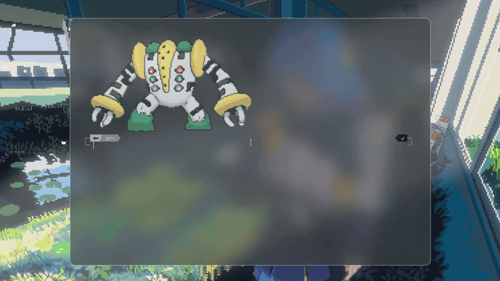
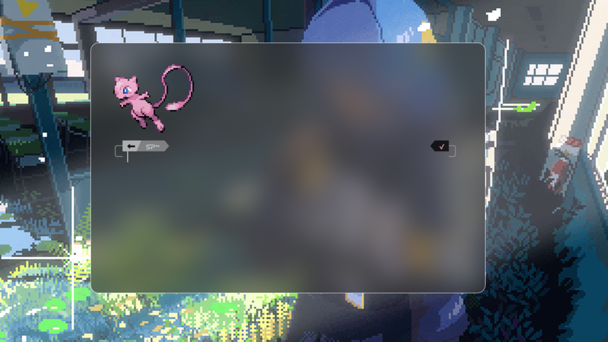
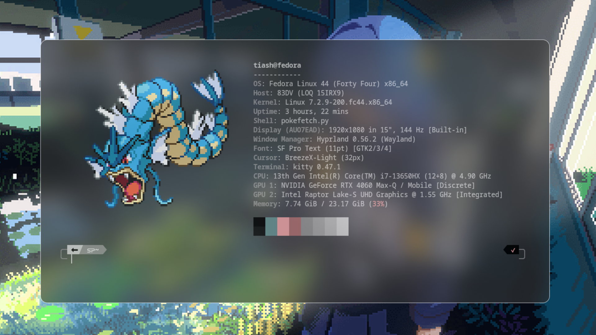

<h1 align="center">pokescripts</h1>

<p align="center">
  Pokémon in your <a href="https://sw.kovidgoyal.net/kitty/">kitty</a> terminal.<br>
  A random sprite on every launch, or a system info screen with a Pokémon as the logo.
</p>

<p align="center">
  <a href="LICENSE"></a>
  
  
  
</p>

<p align="center">
  <a href="#installation">Installation</a> ·
  <a href="#usage">Usage</a> ·
  <a href="#uninstall">Uninstall</a>
</p>

<table align="center">
  <tr>
    <td align="center">
      <br>
      <sub><b>pokemon</b> · Showdown (<code>-shd</code>)</sub>
    </td>
    <td align="center">
      <br>
      <sub><b>pokemon</b> · Generation V (<code>-gen5</code>)</sub>
    </td>
  </tr>
  <tr>
    <td align="center" colspan="2">
      <br>
      <sub><b>pokefetch</b> · fastfetch with a Pokémon logo</sub>
    </td>
  </tr>
</table>

---

Two small scripts for the [kitty](https://sw.kovidgoyal.net/kitty/) terminal:

- **`pokemon`** shows a random Pokémon sprite every time the terminal starts.
- **`pokefetch`** runs [fastfetch](https://github.com/fastfetch-cli/fastfetch) with a random Generation V Pokémon as the logo.

## Requirements

| Tool | Needed for |
|------|-----------|
| Python 3 | everything |
| git | installation |
| [kitty](https://sw.kovidgoyal.net/kitty/) | everything (sprites are drawn with kitty's image protocol) |
| [fastfetch](https://github.com/fastfetch-cli/fastfetch) | `pokefetch` only |

Installing fastfetch:

```bash
sudo apt install fastfetch      # Debian / Ubuntu
sudo pacman -S fastfetch        # Arch
sudo dnf install fastfetch      # Fedora
brew install fastfetch          # macOS
```

## Installation

You choose three things:

1. **What to install:** `pokemon`, `pokefetch`, or both.
2. **Art style** (pokemon only): Showdown (GIF, Pokémon #1-982) or Generation V (PNG, Pokémon #1-643). `pokefetch` always uses Gen V.
3. **What runs when a terminal opens:** the one you installed, or, if you installed both, either one or neither.

Only the aliases for what you install are added to your shell config.

### Automatic (recommended)

The installer clones the repo to `~/pokescripts` and edits `~/.zshrc` or `~/.bashrc`. It detects your shell, backs up your config before editing, and never adds the lines twice.

Interactive (asks you all three questions):

```bash
curl -fsSL https://raw.githubusercontent.com/Neuralized3/pokescripts/main/install.sh | bash
```

Or skip the questions with options:

| Option | Meaning |
|--------|---------|
| `-pokemon` / `-pokefetch` / `-both` | what to install |
| `-shd` / `-gen5` | pokemon art style (`-shd` or `-gen5` alone implies `-pokemon`) |
| `-startup=pokemon` / `-startup=pokefetch` / `-startup=none` | what runs on terminal start (default: whatever you installed; with `-both`, asked) |

```bash
# pokemon only, Showdown sprites
curl -fsSL https://raw.githubusercontent.com/Neuralized3/pokescripts/main/install.sh | bash -s -- -pokemon -shd

# pokemon only, Generation V sprites
curl -fsSL https://raw.githubusercontent.com/Neuralized3/pokescripts/main/install.sh | bash -s -- -pokemon -gen5

# pokefetch only
curl -fsSL https://raw.githubusercontent.com/Neuralized3/pokescripts/main/install.sh | bash -s -- -pokefetch

# both, pokemon (Showdown) runs on startup
curl -fsSL https://raw.githubusercontent.com/Neuralized3/pokescripts/main/install.sh | bash -s -- -both -shd -startup=pokemon

# both, pokefetch runs on startup (pokemon stays available by hand, Gen V style)
curl -fsSL https://raw.githubusercontent.com/Neuralized3/pokescripts/main/install.sh | bash -s -- -both -gen5 -startup=pokefetch

# both, nothing on startup
curl -fsSL https://raw.githubusercontent.com/Neuralized3/pokescripts/main/install.sh | bash -s -- -both -startup=none
```

Already cloned the repo? Run the installer from inside it, with the same options:

```bash
bash ~/pokescripts/install.sh -both -shd -startup=pokemon
```

To switch later, run the installer again with different options. It replaces the old setup instead of duplicating it. `bash install.sh -h` lists every option.

### Manual

1. Clone the repo into your home directory under the name `pokescripts`:

   ```bash
   git clone https://github.com/Neuralized3/pokescripts.git ~/pokescripts
   ```

2. Add the lines for your choice to your shell config. Set `RC` to the file for your shell, then run **one** of the commands below.

   ```bash
   RC=~/.zshrc      # zsh
   RC=~/.bashrc     # bash
   ```

   **pokemon only, Showdown sprites on startup:**

   ```bash
   printf "\n# >>> pokescripts >>>\nalias pokemon='python3 ~/pokescripts/pokemon.py'\npokemon -shd\n# <<< pokescripts <<<\n" >> "$RC"
   ```

   **pokemon only, Generation V sprites on startup:**

   ```bash
   printf "\n# >>> pokescripts >>>\nalias pokemon='python3 ~/pokescripts/pokemon.py'\npokemon -gen5\n# <<< pokescripts <<<\n" >> "$RC"
   ```

   **pokefetch only (runs on startup):**

   ```bash
   printf "\n# >>> pokescripts >>>\nalias pokefetch='python3 ~/pokescripts/pokefetch.py'\npokefetch\n# <<< pokescripts <<<\n" >> "$RC"
   ```

   **Both, pokemon (Showdown) runs on startup:**

   ```bash
   printf "\n# >>> pokescripts >>>\nalias pokemon='python3 ~/pokescripts/pokemon.py'\nalias pokefetch='python3 ~/pokescripts/pokefetch.py'\npokemon -shd\n# <<< pokescripts <<<\n" >> "$RC"
   ```

   **Both, pokefetch runs on startup:**

   ```bash
   printf "\n# >>> pokescripts >>>\nalias pokemon='python3 ~/pokescripts/pokemon.py'\nalias pokefetch='python3 ~/pokescripts/pokefetch.py'\npokefetch\n# <<< pokescripts <<<\n" >> "$RC"
   ```

   **Both, nothing on startup:**

   ```bash
   printf "\n# >>> pokescripts >>>\nalias pokemon='python3 ~/pokescripts/pokemon.py'\nalias pokefetch='python3 ~/pokescripts/pokefetch.py'\n# <<< pokescripts <<<\n" >> "$RC"
   ```

   Prefer to edit the file yourself? Paste this into it and keep only the lines you want:

   ```bash
   alias pokemon='python3 ~/pokescripts/pokemon.py'
   alias pokefetch='python3 ~/pokescripts/pokefetch.py'
   pokemon -shd        # startup: Showdown sprites (GIF)
   # pokemon -gen5     # startup: Generation V sprites (PNG)
   # pokefetch         # startup: fastfetch with a Pokémon logo
   ```

   Only enable one startup line, otherwise two images show on every launch.

3. Reload your shell config (or just open a new kitty window):

   ```bash
   source "$RC"
   ```

### Uninstall

```bash
bash ~/pokescripts/install.sh -uninstall   # removes the block from your shell config
rm -rf ~/pokescripts                       # optional: delete the repo
```

## Usage

### pokemon

```
Usage: pokemon <style> [name]
Styles:
  -gen5    Generation V sprites (PNG), Pokémon #1-643 only
  -shd     Pokémon Showdown sprites (GIF), Pokémon #1-982
Examples:
  pokemon -gen5              random Gen V sprite (png)
  pokemon -shd               random Showdown sprite (gif)
  pokemon -shd pikachu       a specific Pokémon
  pokemon -gen5 articuno     names match the file names
                             (nidoran-f, articuno, ho-oh)
```

### pokefetch

Shows your system info with fastfetch, using a Generation V sprite as the logo.

```
Usage: pokefetch [options] [name]
Runs fastfetch with a Generation V Pokémon as the logo.
Options:
  --scale N        logo size multiplier (default 1.3; 1 = native pixels)
  --pad-left N     blank columns left of the logo (default 5)
  --pad-right N    blank columns between the logo and the info (default 8)
  -help            show this guide
Examples:
  pokefetch                              random Pokémon
  pokefetch charizard                    a specific Pokémon
  pokefetch --scale 2 pikachu            bigger
  pokefetch --scale 0.8                  smaller, random Pokémon
  pokefetch --pad-left 0 --pad-right 2   compact layout
  pokefetch nidoran-f                    names are lowercase and match the
                                         file names (nidoran-f, ho-oh)
Ideas:
  export POKEFETCH_SCALE=2               your default size, put it in ~/.zshrc
                                         or ~/.bashrc
  alias pf='pokefetch --scale 1.8'       a shortcut with your favourite settings
  pokefetch --scale 3 mewtwo             a big showpiece
  pokefetch --scale 1 --pad-left 0       tiny logo, hugging the left edge
```

The logo is sized automatically: each sprite is scaled by the same factor from its real pixel size and your terminal's cell size, so small Pokémon stay small and large ones stay large, on any font or zoom level.

#### Changing the size

Pick whichever fits how often you want to change it. The first one found wins: flag, then environment variable, then the default in the file.

| Method | Example | Lasts |
|--------|---------|-------|
| Flag | `pokefetch --scale 2` | one run |
| Environment variable | `export POKEFETCH_SCALE=2` in your `~/.zshrc` / `~/.bashrc` | every terminal |
| Edit the file | change `SCALE`, `PAD_LEFT` or `PAD_RIGHT` at the top of `~/pokescripts/pokefetch.py` | permanently (a `git pull` may overwrite it) |

`1` is the sprite's native pixel size, so `1.3` is a bit larger, `2` is double, and `0.8` is smaller. `--pad-left` and `--pad-right` take whole numbers of columns.

To preview a size without touching any script, run fastfetch directly from `~/pokescripts/gen5`:

```bash
fastfetch --logo-type kitty-icat --logo pikachu.png --logo-width 12 --logo-height 6 --logo-padding-left 10 --logo-padding-right 10
```

## License

The code in this repository is released under the [MIT License](https://mit-license.org/).

The MIT License covers the code only. It does **not** cover the sprite images.

## Disclaimer

This is an unofficial, non-commercial fan project. Pokémon and all related names, characters, and sprites are trademarks and copyrights of Nintendo, Game Freak, and Creatures Inc. This project is not affiliated with or endorsed by them.
Pokefetch's scaling function along with path finder function, installation script and Readme.md was generated by claude. Rest of the code is human crafted.
Sprite sources and credits:

- [PokeAPI](https://github.com/PokeAPI/sprites) for the Generation V sprites
- [Pokémon Showdown](https://play.pokemonshowdown.com/) / Smogon and its sprite artists for the Showdown sprites
- [fastfetch](https://github.com/fastfetch-cli/fastfetch) for the system info display used by `pokefetch`
